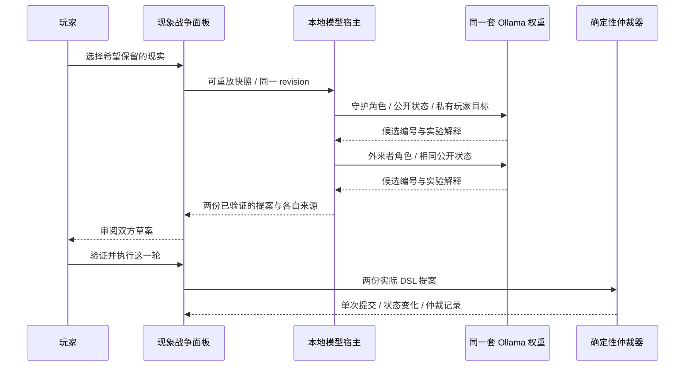

# EFF 0.3：本地 AI 与双代理对战

日期：2026-10-14。0.2 本地版已通过 PR #6 合入 main（529afdb）。本轮扩展 P3，不改变原文、九种结局和终章无意识的介入条件。

## 已实现的运行方式

两个角色的 system 与 user 消息独立创建。外来者只能看公开的游戏事件及最多三轮已经提交的轨迹，收不到当前玩家目标、手写 JSON 或守护侧当前草案。两次生成依次调用同一模型，避免同时加载两份权重。共享模型不意味着两个独立信任根。

模型选择合法候选编号并给出最多 180 字的实验解释；宿主将编号映射为核心定义的完整 DSL，再检查动作、证据、目标与版本。候选包括三项独立回应、有限排序和检查点保全；模型不能自行增加动作或宣布结果。研究模式可以保留玩家手写提案，只让外来者生成。模型的解释标为实验内容，是否受理以仲裁轨迹为准。

## 玩家入口

1. 启动自己已安装的 Ollama；游戏不会启动服务或拉取权重。
2. 打开 EFF.exe 主菜单，点击“检测服务与模型”。该操作才读取本地模型列表和内存数量，不扫描个人文件、浏览历史或进程。
3. 选择已安装的本地对话模型及预算，点击“启用双代理”。模型名称带 cloud 或 `/api/show` 明确指向远端的别名会被拒绝。
4. 进入现象战争，或先练习。选择目标，研究方案，查看两侧模型/模板来源，然后明确执行。

全程只由可信主进程请求固定 `127.0.0.1:11434` 的 tags/show/chat。禁止 HTTP 重定向；渲染器不能直接联网。检测不是启用，启用也不会自动提交回合。浏览器预览与未开启模型的本地版继续使用规则模板。

## 资源与取消

| 档位 | 每侧预算 | 上下文 token | 输出 token |
| --- | --- | --- | --- |
| 轻量 | 8 秒 | 2048 | 192 |
| 平衡（默认） | 20 秒 | 3072 | 320 |
| 耐心 | 45 秒 | 4096 | 384 |

两侧串行，最坏等待时间为每侧预算之和。窗口、输入、停止和关闭按钮继续响应，主线倒计时明确暂停。生成响应最多 32 KiB，检测响应最多 128 KiB；模型列表最多 128 项。每次请求禁止工具调用，关闭 thinking，并以 JSON schema 限制候选编号和解释长度。权重最多请求保温 30 秒，以减少同轮第二次加载；这是用户 Ollama 的有限缓存时间，不是 EFF 自建后台任务。

任一侧超时、坏 JSON、未知候选或服务错误时，仅该侧回退模板并显示来源；有效的另一侧可以继续使用。取消、换目标、换模式、停止 AI、返回菜单及退出会废弃旧结果并中止未完成的请求；取消期间不提交回合。禁用后，尚未完成的模型检测不能再次启用 AI。用户自己的服务不由游戏终止。

## 存档与重放

额外实验存档从 v1 升级到 v2，兼容读取 v1。最多六轮保存实际双方 DSL 和可重放检查点；另记模型/模板/玩家来源、模型名、生成时长与有限实验解释。读档先重放动作确认状态，之后恢复来源注记，不调用模型重新猜测动作。注记不决定胜负；这是本地记录，不是防用户修改的签名。

庭院前不署名压抑；只有原雨塔记忆完成后显示其姓名。练习不改变主线。庭院成功仍返回原拒绝段，并保留三项原文动作；实验不会提前授予历史回写。

## 实际测量与验收

使用本机已有 Ollama 0.32.4、qwen3.5:4b（4.2B / Q4_K_M）完成三轮、六份生成提案，全部通过验证，没有模板回退；实际动作改变了身体、归责与结局状态，重放完全一致。一次耐心档测试首次约 9.95 秒，后续每侧约 1.42–2.16 秒。此样本只代表这台机器与这些回合，不给出通用最低配置或所有模型的质量保证。

实际 Electron 窗口还验证了平衡档双侧来源、生成不自动执行、保存和刷新、取消后旧草案不再出现、停止后模板回退、推理中关闭与本游戏进程结束。129 项自动检查（100 原剧情、29 仲裁/宿主/代理）通过；窗口与真实权重检查另行执行。

源码入口：`desktop/model-client.cjs`、`local-version/agent-bridge.js`、`repression-ui.js`。自动检查：`tests/local-agents.test.cjs`；显式真实模型检查：`tests/local-model-live.cjs` 与 `tests/local-native-ai.cjs`，需设置 EFF_LIVE_MODEL，不下载或启动服务。当前不实现任意生成代码、Wasm 规则迁移或虚拟引擎自演化。

## 官方接口参考

- [Ollama chat：结构化输出、think 与 keep_alive](https://docs.ollama.com/api/chat)
- [已安装模型列表](https://docs.ollama.com/api/tags)
- [JSON schema 结构化输出](https://docs.ollama.com/capabilities/structured-outputs)
- [Ollama 本地服务与缓存配置](https://docs.ollama.com/faq)
