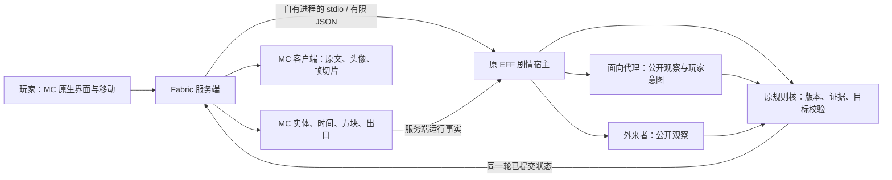

# MC 旁支：实现框架与边界

## 数据流

## 选择这条路线的原因

MC 26.3 的 Fabric 模组直接承载场景与交互，既有 EFF 引擎通过本地 Node 子进程继续运行。这样能够保留正文和终章的原有操作，避免为移植而重写、删短剧情；现象战争的结果则有可检查的 MC 执行对象。

模型请求沿用既有 `desktop/model-client.cjs`，仅增加有限的 MC 观察。原始模型文本不进入游戏源码解释器。文档宿主的 VM 用于加载仓库中的可信游戏脚本，不被当作抵御任意恶意 JS 的操作系统沙箱。

## 服务端权威

客户端只允许进入模式、原文交互、选择目标、请求建议、采用建议、暂停、模型配置和离开等操作。客户端不能提交 `tick`、伪造世界运行回执、传送坐标、方块命令、任意 URL、进程命令或源码。

服务端从自己的玩家位置计算 EFF 坐标，采集实际冻结状态与出口状态，再驱动宿主时钟。所有 MC 方块与实体改动回到服务器主线程执行；模型请求异步等待，不占住该线程。投影序号单调增长，晚到的旧界面状态不会覆盖新状态。

## 两个代理的分离

两侧提案引用同一个 `battle_id` 和 `observed_revision`。面向得到玩家目标，外来者得不到该私有字段；第一侧的草案也不会加入第二侧消息。两者共享本地权重，使用各自独立的消息。只有规则核接受的提案才进入一次原子回合。

规则保留身体、归责、结局的独立状态，以及事件顺序、检查点和有限轮数。原文之旅中还校验当前原文句子允许回应的对象，不能用模型建议跳过尚未阅读或尚未授权的段落。无意识的过去介入以原脚本的请求、回写步骤和标志为门槛。

## MC 适配对象

`EffArena` 只构建 `eff:phenomenon` 的场地。每次场景切换或重建使用新的投影区域；方块批次有每 tick 预算。人物、调查点与碎片均为本模组自建对象。原世界的方块、背包与其他模组文件不作为攻防对象。

身体控制通过服务端位置执行约束体现；MC 的 tick 冻结使用真实服务器时间管理器。由于这个状态会影响整台服务器，0.1.0 只接受单人；其他玩家加入便退出恢复，而不是冻结旁观玩家。

终章记录本场地的方块检查点。介入授权以前只呈现当前过程的破损；授权后随原文步骤恢复对应部分，整章回写后再完成恢复。这里没有另造一个已经发生过的平行故事来替代原文。

## 表象撕裂

在 `GameRenderer.render` 完成时，复制 MC 实际渲染目标；GUI 提取阶段仅提交切片绘制。切片、黑场与代码层外露读取已提交的状态，不能代替服务端判定。旧渲染目标延后并通过 GPU fence 回收。

重建包括两件独立的事：画面从旧帧分离，以及 MC 生成新场地并迁移玩家。Minecraft JVM 没有被杀死或热替换。减少动效只改变演出，不改变争夺结果。

## 恢复与存档

原文进度放在该世界的 `eff-runtime/<玩家 UUID>/`，与浏览器、桌面第四版及独立练习分离；练习不写回原文进度。规则检查点使用原内核回放验证。交互标识绑定实际可见控件，过期剧情选择被拒绝；仍在场的活动雨滴保留身份，不会因位置更新而无法点击。

进入前记录返回位置、维度、视角、游戏模式、能力、重力、食物与原冻结状态。主动离开、断线、服务器停止和桥接失联都经过恢复路径；另写返回票据供异常关闭后的再次进入恢复。只关闭本模组持有的子进程句柄。

剧情宿主不对外开 HTTP 端口。Ollama 连接固定为本机环回地址，禁用远程与云端模型别名。原小说原始文稿、模型权重、MC 本体与用户账户凭据不纳入新增源码包；游戏既有脚本文字作为运行依赖打包。

## 验收范围

本机验证 Java 25、MC 26.3、Fabric 0.19.5 与 Fabric API 0.163.0+26.3。原有脚本回归验证内容与逻辑，新增桥接检查验证适配协议；原生开发客户端再验证真实世界执行、两侧模型来源和退出恢复。三者是不同的证据层，不能互相替代。

原型尚不宣称完整 MC 逐章通关、多人兼容、各类渲染整合包兼容或所有设备的帧率与推理时延。

官方参考：

- [Minecraft 版本清单](https://piston-meta.mojang.com/mc/game/version_manifest_v2.json)
- [Fabric 当前版本接口](https://meta.fabricmc.net/v2/versions)
- [Fabric 新项目与构建](https://docs.fabricmc.net/develop/getting-started/creating-a-project)
- [Fabric 网络接口](https://docs.fabricmc.net/develop/networking)
- [Fabric GUI / HUD 提取](https://docs.fabricmc.net/develop/rendering/hud)
